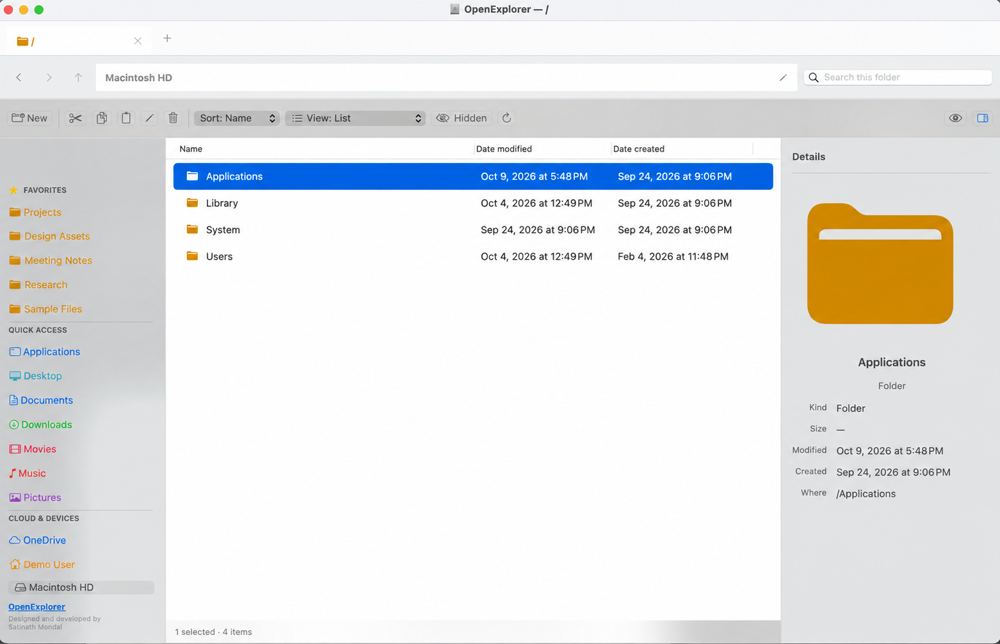

# [OpenExplorer](https://github.com/satinath-nit/OpenExplorer)

OpenExplorer is a native, open-source macOS file manager for people who prefer the direct navigation and layout choices of Windows File Explorer. It is written in Swift with AppKit, runs fully offline, and has no third-party runtime dependencies.

<!-- BEGIN LATEST DOWNLOAD BUTTON -->
[](https://github.com/satinath-nit/OpenExplorer/releases/download/2.0.2/OpenExplorer-arm64.dmg)
<!-- END LATEST DOWNLOAD BUTTON -->



## Features

- Windows-style tabs, clickable breadcrumbs, an editable/copyable address bar, navigation controls, and command bar
- Extra Large, Large, Medium, and Small icon grids
- List, Details, Tiles, and Content layouts
- Independent Details and Preview panes
- Windows-style yellow folder icons
- Recursive, Spotlight-backed search within the current folder, with a filesystem fallback for newly created items that are not indexed yet
- Sortable Name, Date Modified, Date Created, Type, and Size columns; Date Modified defaults to newest-first for every folder
- Favorites, Quick Access, cloud-storage locations, and dynamically discovered mounted devices, including Eject and DMG mounting without opening Finder
- Back and forward history for each tab
- Create folders and blank files of any type, then open, rename, copy, cut, paste, or move items to the macOS Trash
- Copy and move jobs show progress, support cancellation between items, offer Replace/Keep Both/Skip conflict choices, and can be undone with `⌘Z`
- Drag files and folders between OpenExplorer folders in List or icon views, or drag them into other macOS applications
- Browse and empty the macOS Trash, and restore items sent there by OpenExplorer to their original location
- Get Info displays calculated size, ownership and permissions; POSIX permissions and the Locked flag can be edited
- Connect to SMB, AFP, NFS, and WebDAV server addresses from the sidebar
- Extract ZIP archives directly inside OpenExplorer without opening Finder; extracted folders appear automatically and use a safe numbered name when needed
- Live folder monitoring keeps the current view synchronized with downloads, Archive Utility, Terminal, and other applications without requiring a manual refresh
- Quick Look integration remains available for native macOS previews, alongside an **Open With** menu that discovers compatible installed applications and provides **Choose Application…**
- Built-in plain-text editor for dotfiles and text files such as `.zshrc`, `.bashrc`, `.env`, Markdown, JSON, and source code, with line numbers, Find, line wrapping, external-change protection, and `⌘S` Save
- Optional hidden-file display
- Folder context actions to copy a home-relative path or open the location in Terminal
- Persistent last folder, favorites, pane choices, and view mode
- Finder-style app lifecycle: closing the last window keeps OpenExplorer in the Dock, ready to reopen
- Installed version displayed in the sidebar footer and the standard About OpenExplorer panel
- Native shortcuts including `⌘N` New Tab, `⌘W` Close Window, `⌘X` Cut, `⌘C` Copy, `⌘V` Paste, `⌘Z` Undo, `⌘I` Get Info, `⇧⌘N` New Folder, and `⌘L` Location
- System-wide `⌘E` shortcut to bring OpenExplorer forward or restore its closed window while it is running in the Dock

## System requirements

- macOS 13 Ventura or newer
- Apple silicon or Intel Mac
- Swift 6 or newer when building from source
- Xcode or the standalone Xcode Command Line Tools

OpenExplorer uses native macOS APIs including AppKit, Quick Look, and the Trash. Windows and Linux are not supported.

### Trash access

macOS protects the Trash from third-party applications. The first time you open Trash, OpenExplorer may ask you to add it in **System Settings > Privacy & Security > Full Disk Access**. After enabling OpenExplorer, quit and reopen the app. OpenExplorer links directly to this setting when access is denied; it cannot grant the permission itself.

## Clone the repository

```bash
git clone https://github.com/satinath-nit/OpenExplorer.git
cd OpenExplorer
```

## Install the build tools

Install Apple's Xcode Command Line Tools if they are not already installed:

```bash
xcode-select --install
```

Confirm that Swift and the active macOS SDK are available:

```bash
swift --version
xcrun --sdk macosx --show-sdk-path
```

If you have multiple Xcode installations, select the intended one before building:

```bash
sudo xcode-select --switch /Applications/Xcode.app/Contents/Developer
```

## Build and run from source

Run the development build directly with Swift Package Manager:

```bash
swift run OpenExplorer
```

The development executable has the same file-management features as the packaged application. The generated app icon and bundle metadata are added by the packaging script.

## Run tests

```bash
./scripts/test.sh
```

This builds the shared core and runs its checks. After packaging, run the UI startup smoke test:

```bash
./scripts/smoke-test-app.sh
```

The smoke test verifies that the application opens a visible key window, adapts to light and dark appearance, exposes address and folder-location actions, preserves List columns across view changes, remains running after its last window closes, reopens from the Dock, and routes standard shortcuts including `⌘W` Close Window and `⌘X` Cut to the explorer window.

## Build the macOS application and DMG

Run the packaging script on macOS:

```bash
./scripts/package-macos.sh
```

The script automatically uses:

- the SDK selected by `xcrun` or the optional `SDKROOT` environment variable;
- the current machine architecture from `uname -m` or the optional `OPENEXPLORER_ARCH` environment variable;
- the version stored in `Resources/Info.plist`.

Outputs are written to:

```text
release/OpenExplorer.app
release/OpenExplorer-<version>-<architecture>.dmg
```

For example, an Apple-silicon build of version 2.0.2 produces:

```text
release/OpenExplorer-2.0.2-arm64.dmg
```

To request a specific architecture supported by the installed toolchain:

```bash
OPENEXPLORER_ARCH=arm64 ./scripts/package-macos.sh
```

## Install a local build

Open the generated DMG and drag `OpenExplorer.app` into the Applications folder, or install from Terminal:

```bash
ditto --rsrc --extattr --acl release/OpenExplorer.app /Applications/OpenExplorer.app
open /Applications/OpenExplorer.app
```

The local package is ad-hoc signed, not notarized. On first launch, macOS may require you to Control-click the app, choose **Open**, and confirm. macOS may also request access when browsing protected locations such as Desktop, Documents, Downloads, external drives, or network shares.

Public distribution requires an Apple Developer ID Application certificate and Apple notarization in addition to this local packaging process.

## Project structure

```text
OpenExplorer/
├── Package.swift
├── LICENSE
├── README.md
├── Resources/
│   ├── Info.plist
│   ├── OpenExplorer.icns
│   └── OpenExplorerIcon.png
├── Sources/
│   ├── OpenExplorer/
│   ├── OpenExplorerCore/
│   └── OpenExplorerCoreChecks/
└── scripts/
    ├── package-macos.sh
    ├── smoke-test-app.sh
    ├── startup-stability-test.sh
    └── test.sh
```

The `OpenExplorer` target contains the AppKit UI and filesystem operations. `OpenExplorerCore` contains reusable navigation and formatting logic. `OpenExplorerCoreChecks` is a dependency-free executable test target.

## Publish to this GitHub repository

If this directory is not already its own Git repository:

```bash
git init
git add .
git commit -m "Initial OpenExplorer release"
git branch -M main
git remote add origin https://github.com/satinath-nit/OpenExplorer.git
git push -u origin main
```

If the remote already contains files, review and integrate them before pushing. Do not force-push unless you intentionally want to replace the remote history.

Generated builds, installers, logs, editor settings, local agent state, and secrets are excluded by `.gitignore`.

## Privacy and security

OpenExplorer has no telemetry, account system, updater, network service, or cloud upload. It reads and changes only the filesystem locations the user chooses to manage. Local preferences are stored through the standard macOS user-defaults system.

Move to Trash is recoverable through the macOS Trash. Other file operations use the current user's filesystem permissions.

## Contributing

Issues and pull requests are welcome at [github.com/satinath-nit/OpenExplorer](https://github.com/satinath-nit/OpenExplorer). Before submitting a change, run:

```bash
./scripts/test.sh
./scripts/package-macos.sh
./scripts/smoke-test-app.sh
```

## License

OpenExplorer is available under the [MIT License](LICENSE).
